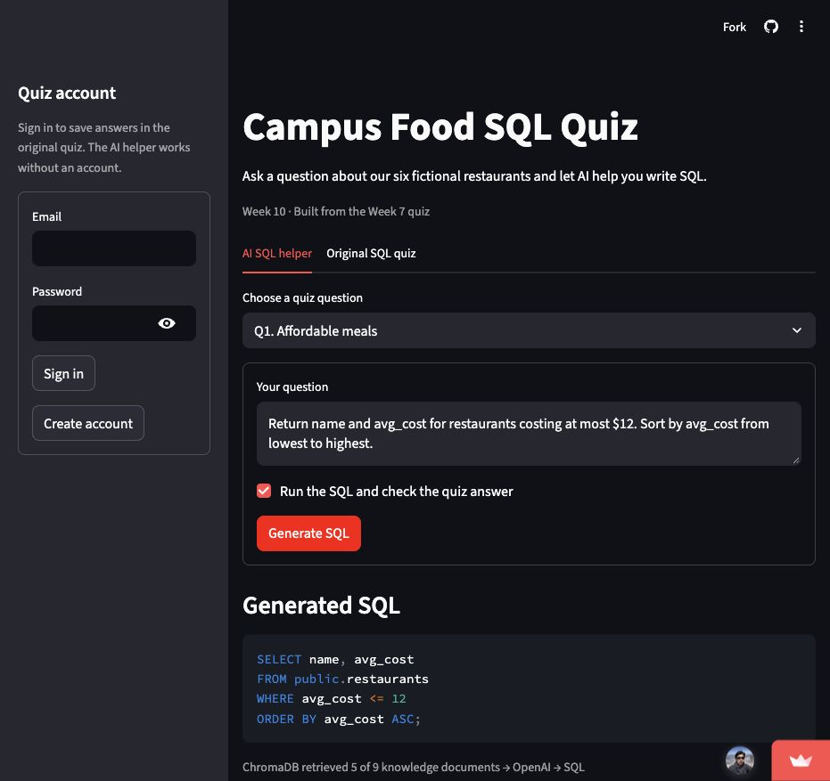
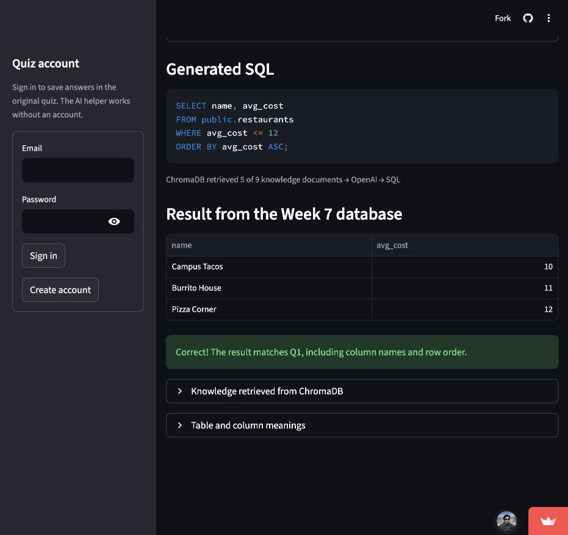

# Campus Food SQL Quiz

This app adds an AI SQL helper to my [Week 7 quiz](https://github.com/xuxingcheng/IDS706-Week7-Assignment). It uses the same Supabase PostgreSQL database.

**Website:** https://ids706-week10-campus-food.streamlit.app/

## How to use

1. Choose a quiz question or type your own question.
2. Click **Generate SQL**.
3. See the SQL, result table, and answer check.
4. Open **Knowledge retrieved from ChromaDB** to see what the AI used.

The **Original SQL quiz** tab lets you write SQL yourself. Sign in to run and save those answers.

## How it works

Question → ChromaDB search → OpenAI Responses API → SQL.

ChromaDB uses MiniLM embeddings to search the database schema, column meanings, and example queries. OpenAI uses the retrieved information to write SQL. The app runs SELECT queries with a read-only database login. It also checks answers for the five quiz questions.

## Run locally

Use Python 3.11.

```bash
pip install -r requirements.txt
cp .env.example .env
streamlit run app.py
```

Before starting the app, add your Week 7 database settings, Supabase Auth settings, and `OPENAI_API_KEY` to `.env`. The default model is `gpt-6.1-sol`. The first question downloads the embedding model. Do not commit `.env` or API keys.

For Streamlit Community Cloud, use `app.py`, Python 3.11, and add the same settings in app secrets.

## Screenshots

Question and generated SQL:



Read-only query result and answer check:


